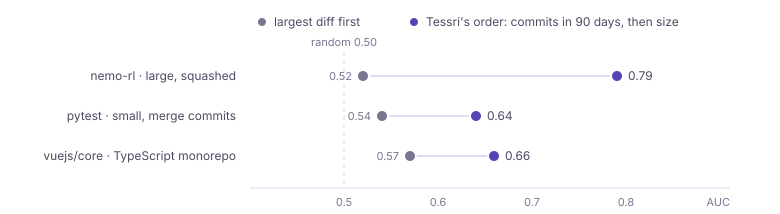

# The backtest: how the order and the graph were tested

`tessri triage` orders the files of a change by recent activity and then by the size of the change, and
`tessri impact` treats the files one import away as the review set. Both are claims about what happens next, so
both are tested on history rather than assumed. `tools/backtest.py` runs the test on any repository; this page is
its method and its output on three: a large, young repository that squashes every pull request, a small, old one
that merges them with merge commits, and a TypeScript monorepo with a small core team.



```bash
python3 tools/backtest.py path/to/repository --months 12                   # from a checkout of Tessri
python3 tools/backtest.py path/to/repository --format json --out backtest.json
```

## What is measured

**The order.** A change is one commit on the first-parent line of the branch: on a branch that squashes or rebases
that is every commit, and a merge commit counts as the whole of what it merged. A row is one code file a change
touched, scored with what git knew when the change landed: the commits that touched the file in the 90 days before
it, how many of those were fixes or reverts (by the subject rule `triage` uses: `fix`, `fixes`, `bugfix`, `hotfix`,
`revert`), the lines the change moved in it, and how many files imported it in the tree at the month's start. The
outcome is whether a commit whose subject says fix or revert touched the file within the following 30 days. Nothing
from after a change goes into its score; the last 30 days of history are not scored because their outcome is not
known yet, and neither are the first 90, which have no full window of activity before them.

Each order is judged by its AUC: the probability that a file later fixed is sorted above one that was not, ties
counting half, so 0.5 is chance and 1.0 is perfect. It is given pooled over every row, as the mean over the months,
as the number of months in which the order beat "size", and within a change, the mean over the changes that had
both a file later fixed and one not, which is the question `triage` actually answers.

**The graph.** For each month the tree before the month's first change is analysed, and every pair of code files
(tests apart) falls in one class: one import statement apart in either direction, two apart, in the same directory
with no import between them, or unrelated. A pair co-changed when one change of the month touched both files; a
change touching more than 50 code files is left out. The rate of each class is compared with the rate of the
unrelated pairs.

## The result on a large repository

The public `nemo-rl` repository at commit `bf33dd52e`, which squashes every pull request; read on 2026-11-09, in
twelve seconds:

```text
Tessri backtest of nemo-rl at bf33dd52e (history 2025-03-18 to 2026-08-26, 1,370 changes on the first-parent line)

Rows: 3,981 code files touched by 895 changes in 12 months (2025-08 to 2026-07); the outcome, a fix or revert
commit touching the file within 30 days, holds for 32% of them. Activity is commits in the 90 days before the
change; a deleted file is left out; a moved file counts under its new name.

Order                            pooled AUC  mean of months  ahead of size  within a change (changes)
activity, then size (triage)           0.79            0.78       11 of 12                 0.81 (314)
size                                   0.52            0.51              -                 0.48 (314)
activity                               0.79            0.77       11 of 12                 0.79 (314)
fixes, then activity, then size        0.78            0.76       11 of 12                 0.79 (314)
dependents, then size                  0.62            0.58       10 of 12                 0.58 (314)

Pairs of code files (tests apart) in the tree at each month's start, and whether one change of the month
touched both; 0 changes touching more than 50 code files left out.

Pairs                pairs  co-changed    rate  x unrelated  over the months
one import apart     6,432       1,026  15.95%         18.3      8.1 to 56.5
two imports apart   35,839       2,679   7.48%          8.6      4.3 to 35.1
same directory       2,688          50   1.86%          2.1       0.0 to 9.3
unrelated          169,197       1,473   0.87%          1.0       1.0 to 1.0
```

Read it this way:

- **Activity is the signal.** Files ordered by recent commits are where the next fix lands: 0.79, against chance
  for the size of the change (0.52), in eleven of twelve months, and 0.81 within a change, where size is below chance
  (0.48). Size only breaks ties.
- **Fix history adds nothing.** Putting the files with recent fixes first scores 0.78, no better than activity alone,
  so `triage` shows `fixes_90` and does not sort by it.
- **Dependents are a weaker signal** (0.62), so they stay context: what a mistake could reach, not how likely one is.
- **One import apart is the review set.** Those pairs changed together 18 times as often as unrelated pairs, two
  imports apart 9 times, and the same directory with no import between them twice. That is why `impact` and `triage`
  count dependents at one and two hops, and why "nearby" is not "related".

The month-by-month ratios swing (8 to 57 for one import apart) because the unrelated rate is small and a quiet month
makes it smaller; the pooled number is the one to quote.

## The result on a small repository

The public `pytest` repository at commit `50234b4e6`, which merges pull requests with merge commits, so a change on
the first-parent line is a whole pull request; 131 code files, tests apart, at that commit, against 385 in `nemo-rl` at
its.
Read on 2026-11-15, in eight seconds:

```text
Tessri backtest of pytest at 50234b4e6 (history 2007-01-24 to 2026-11-15, 7,866 changes on the first-parent line)

Rows: 683 code files touched by 475 changes in 12 months (2025-11 to 2026-10); the outcome, a fix or revert
commit touching the file within 30 days, holds for 14% of them. Activity is commits in the 90 days before the
change; a deleted file is left out; a moved file counts under its new name.

Order                            pooled AUC  mean of months  ahead of size  within a change (changes)
activity, then size (triage)           0.64            0.65        6 of 10                  0.62 (47)
size                                   0.54            0.54              -                  0.47 (47)
activity                               0.64            0.64        6 of 10                  0.64 (47)
fixes, then activity, then size        0.64            0.66        6 of 10                  0.63 (47)
dependents, then size                  0.59            0.63        7 of 10                  0.60 (47)

Pairs of code files (tests apart) in the tree at each month's start, and whether one change of the month
touched both; 0 changes touching more than 50 code files left out.

Pairs               pairs  co-changed   rate  x unrelated  over the months
one import apart    5,694         260  4.57%         82.2     0.0 to 192.8
two imports apart  36,569         284  0.78%         14.0      0.6 to 36.0
same directory      1,956           3  0.15%          2.8      0.0 to 27.5
unrelated          48,633          27  0.06%          1.0       1.0 to 1.0
```

Read it this way:

- **The order holds, by less.** Activity then size scores 0.64 against 0.54 for size, and 0.62 against 0.47 within a
  change, but it is ahead in only six of ten months and the within-change set is 47 changes. A change here touches two
  code files at the median, and in a repository this small nearly every file is recently touched: 11% of the rows had
  no commit in the 90 days before, against 28% in `nemo-rl`, so the count separates less. Where everything is active,
  recency says less.
- **Fix history and dependents again add nothing.** 0.64 and 0.59, against 0.64 for activity alone.
- **The graph's classes keep their order; the multipliers do not travel.** One import apart co-changed 82 times as
  often as unrelated pairs, two apart 14 times, the same directory 2.8 times: the same ranking as in `nemo-rl`, and
  ratios that cannot be compared with it, because with 120 code files only 27 unrelated pairs co-changed in the whole
  year, so the rate they divide by is tiny and a quiet month puts the monthly ratio anywhere from 0 to 190. The rates
  are the numbers to compare: 4.6% of the pairs one import apart co-changed in a month (16% in `nemo-rl`), 0.15% of
  the same-directory pairs (1.9%).

Two checks on the same repository, because the sample is small and the fix label is the tool's rule, not pytest's:

- **More history.** Over 36 months (2,672 rows from 1,310 changes) the order scores 0.69 against 0.57, ahead in 20 of
  29 months, and 0.68 against 0.47 within a change (104 changes); fixes first 0.71 pooled but 0.66 within a change,
  dependents 0.63. The pairs over 36 months: one import apart 9.4 times unrelated, two apart 3.1, the same directory
  1.4, with four changes over 50 files left out; months with repository-wide changes raise the unrelated rate and pull
  every ratio down.
- **pytest's own fix label.** pytest records a bug fix as a `changelog/<issue>.bugfix.rst` fragment in the pull
  request, whatever its commits' subjects say. The tool's rule catches 76 of the year's 742 commits, while 94 of its
  475 changes add a bugfix fragment, and a subject that mentions fixtures is not a fix. With the fragment as the
  outcome (a change that adds one touched the file within 30 days), the order scores 0.66 against 0.53, ahead in nine
  of twelve months, and 0.75 against 0.54 within a change (72 changes); over 36 months 0.70 against 0.62, and 0.69
  against 0.54 within a change (164). Fix history adds nothing under either label.

So the second repository says what the first said, more quietly: order by activity, break ties by size, show the rest.

## The result on a TypeScript repository

The public `vuejs/core` repository at commit `da101a4ca`: TypeScript, a monorepo of 13 packages under
`packages/` with 332 code files, tests apart (and 208 test files), squashed pull requests, a small core
team and a dependency bot that writes a third of the commits. Read on 2026-11-19, in about a minute:

```text
Tessri backtest of core at da101a4ca (history 2018-09-19 to 2026-11-19, 6,575 changes on the first-parent line)

Rows: 624 code files touched by 426 changes in 12 months (2025-11 to 2026-10); the outcome, a fix or revert
commit touching the file within 30 days, holds for 29% of them. Activity is commits in the 90 days before the
change; a deleted file is left out; a moved file counts under its new name.

Order                            pooled AUC  mean of months  ahead of size  within a change (changes)
activity, then size (triage)           0.66            0.66        8 of 12                  0.64 (64)
size                                   0.57            0.56              -                  0.51 (64)
activity                               0.66            0.65        8 of 12                  0.66 (64)
fixes, then activity, then size        0.67            0.67        9 of 12                  0.64 (64)
dependents, then size                  0.56            0.60        6 of 12                  0.59 (64)

Pairs of code files (tests apart) in the tree at each month's start, and whether one change of the month
touched both; 0 changes touching more than 50 code files left out.

Pairs                pairs  co-changed   rate  x unrelated  over the months
one import apart    14,173          98  0.69%         28.5     9.9 to 131.5
two imports apart  173,993         239  0.14%          5.7      0.0 to 21.5
same directory       1,599           0  0.00%          0.0       0.0 to 0.0
unrelated          466,277         113  0.02%          1.0       1.0 to 1.0
```

Read it this way:

- **The order holds a third time, in another language.** Activity then size scores 0.66 against 0.57 for size,
  ahead in eight of twelve months, and 0.64 against 0.51 within a change (64 changes). The outcome holds for 29% of
  the rows: this repository writes `fix:` subjects, so the tool's label catches far more here than in `pytest` (14%).
- **Fix history is a point ahead here; dependents are not.** Fixes first scores 0.67 against 0.66, nine months
  against eight, and the same 0.64 within a change. On the other two repositories it added nothing, so one point on
  one repository of three is not a reason to reorder; it stays shown and does not rank. Dependents then size scores
  0.56, below activity on every repository so far.
- **The first class of the graph holds; the finer classes are thin here.** Files one import apart co-changed 28 times
  as often as unrelated pairs (0.69% of them in a month, against 0.02%), two apart 5.7 times. Same-directory pairs
  without an import are rare in a monorepo of small packages, 1,599 pairs, and co-changed not once in the year.

Over 36 months (3,715 rows from 1,513 changes) the order scores 0.71 against 0.53, ahead in 23 of 31 months, and
0.66 against 0.50 within a change (240 changes); fixes first 0.71 pooled, 25 of 31 months and 0.67 within a change,
again a point ahead; dependents 0.60. The pairs over 36 months: one import apart 11.5 times unrelated (2.17% against
0.19%), two apart 3.5, the same directory 5.0 (45 co-changes in 4,725 pairs), with four changes over 50 files left
out: the second class and the directory trade places on thin numbers, while the first class is far ahead on every
repository.

So the third repository says what the first two said: order by activity, break ties by size, show the rest; and the
import graph's one-hop claim survives a change of language.

## What it does not measure

- Severity and cost: an outcome is any fix or revert touching the file, a typo as much as an incident, and a
  repository that does not write `fix:` in its subjects shows no outcomes at all.
- Capacity: who was able to look, and whether a file with no active owner is riskier, need review or incident data
  that git does not hold. `triage` shows ownership because it answers who can look, not where trouble lands.
- Other repositories: three histories are a hint, not a proof, and they disagree on the size of the effect (0.79,
  0.64 and 0.66 against the size of the change); a repository that does not write `fix:` in its subjects, or one in
  a language the analyzers do not read, would show the limits of the label and of the graph. An earlier run on the
  first repository, with a slightly different method and scripts that were never published, reached the same
  conclusions (0.72 against 0.64 for the order); this script replaces it.
- Dates are commit dates, so in a repository that merges without rebasing a commit can count as activity a little
  before it landed; and a moved file's earlier history stays under its old name, unlike in `triage`, so it looks
  quieter than it was.

## Run it on yours

Point the script at any repository with a year of history. `--rev` picks the branch, `--window` and
`--active-days` the two windows, `--months 0` scores every month, and `--no-graph` skips the monthly analyses, which
cost a few seconds each on a few thousand files and are what the dependents order and the pairs table need. If size
beats activity on your history, the order is wrong for you: open an issue with the JSON. The order is not
configurable, on purpose: a knob would make the same brief say different things in different places.
